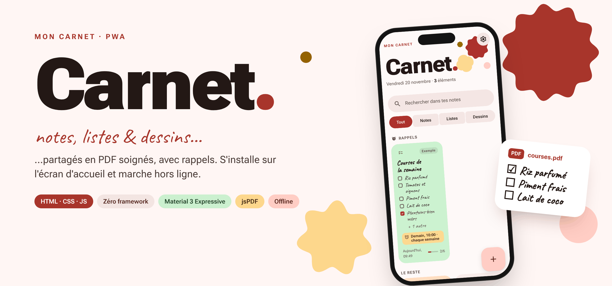

<p align="center">
  
</p>

# Carnet

Carnet personnel en Material 3 Expressive : notes, listes à cocher et dessins, avec partage en PDF soigné (cases cochables) ou en image.

- **Polices** : 5 polices pour l'interface, 6 écritures par note (reprises dans les PDF).
- **Rappels** : un rappel par note, avec répétition, notifications quand l'app est ouverte, pastille sur l'icône et export vers le calendrier (.ics).
- **PWA** : s'installe sur l'écran d'accueil (Safari → Partager → Sur l'écran d'accueil), fonctionne hors ligne.
- **Stockage** : tout reste sur l'appareil (localStorage). Export / import JSON depuis les réglages.
- **Stack** : HTML, CSS et JavaScript sans framework ni build. [jsPDF](https://github.com/parallax/jsPDF) 2.5.1 est embarqué dans `vendor/`.

## Lancer en local

```bash
npx serve .
```

Le service worker ne s'active qu'en HTTPS ou sur `localhost`.

## Structure

```
index.html            app complète (styles + logique)
sw.js                 cache hors ligne
manifest.webmanifest  nom, couleurs et icônes de la PWA
icons/                icônes générées
vendor/               jsPDF
vercel.json           en-têtes pour le service worker
```
